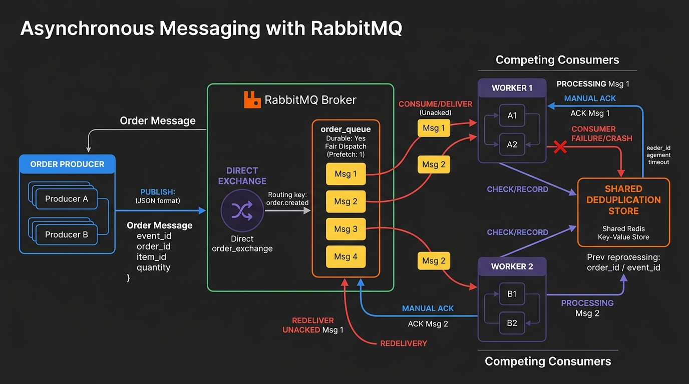
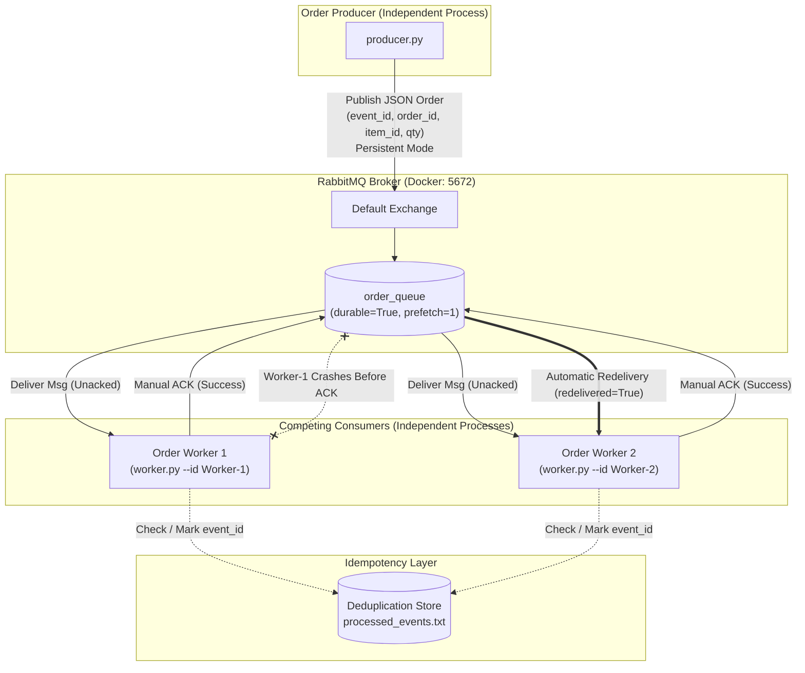

# CMPE 273 Module 5: Asynchronous Messaging System with RabbitMQ

An asynchronous order processing system built with **RabbitMQ** and **Python (`pika`)**. This project demonstrates enterprise messaging patterns including **decoupled producer-consumer architectures**, **competing consumers with fair dispatch**, **manual acknowledgments (ACKs)**, **unacknowledged message redelivery upon consumer crash**, and **idempotent message processing (duplicate handling)**.

---

## Architecture Diagram



### System Architecture Flow (Mermaid)



### Text Architecture Overview

```text
+---------------------+
|   Order Producer    |
|    (producer.py)    |
+----------+----------+
           |
           | JSON Message: {event_id, order_id, item_id, quantity}
           v
+---------------------+
|   RabbitMQ Broker   |  Port: 5672 (AMQP) | Port: 15672 (Management UI)
|  Queue: order_queue |  durable=True, basic_qos(prefetch_count=1)
+----------+----------+
           |
     +-----+-----+ (Competing Consumers: Fair Dispatch)
     |           |
     v           v
+---------+ +---------+
| Worker  | | Worker  |  - Manual ACK on completion
|    1    | |    2    |  - Crash before ACK triggers redelivery
+----+----+ +----+----+  - Deduplication check prevents duplicate actions
     |           |
     +-----+-----+
           |
           v
+---------------------+
| Deduplication Store |  (processed_events.txt / In-Memory Set)
+---------------------+
```

---

## Components

### 1. Order Producer (`producer.py`)
- Connects to RabbitMQ on port `5672` (configurable via `--host` and `--port`).
- Declares a durable queue: `order_queue`.
- Publishes order messages formatted as JSON with persistent delivery mode (`pika.DeliveryMode.Persistent`):
  - `event_id`: Unique identifier for the messaging event (e.g., `evt-1001`).
  - `order_id`: Identifier for the business order (e.g., `ord-5001`).
  - `item_id`: Item SKU/catalog ID (e.g., `item-laptop-m3`).
  - `quantity`: Quantity ordered (e.g., `2`).
- Supports batch publishing (`--count N`), single custom order publishing (`--event-id`, `--order-id`, `--item-id`, `--quantity`), and intentional duplicate publishing (`--send-duplicates`).

### 2. Order Worker (`worker.py`)
- Connects to RabbitMQ, connects to `order_queue`, and configures **Fair Dispatch** using `channel.basic_qos(prefetch_count=1)`.
- Competing consumers: multiple instances consume from the same queue without message overlap.
- Uses **Manual Acknowledgments** (`auto_ack=False` and `ch.basic_ack()`), acknowledging only after business processing succeeds.
- Provides a simulated failure flag (`--crash-on-event <event_id>`) that triggers an immediate process crash (`os._exit(1)`) *before* sending the ACK, validating broker requeue and redelivery.
- Performs **Duplicate Detection (Idempotency)**: checks if `event_id` was already recorded. If duplicate, skips business processing and immediately ACKs the message.

### 3. Automated Verification Runner (`run_demos.py`)
- Orchestrates and captures logs for all three required lab scenarios:
  1. Competing Consumers load distribution.
  2. Failure & Redelivery with worker crash simulation.
  3. Duplicate handling and idempotency.

---

## Instructions for Running

### Prerequisites
- Python 3.9+ installed
- Docker installed (for RabbitMQ container)

### Step 1: Start RabbitMQ Broker
Start RabbitMQ with the Management Web UI using Docker Compose:

```bash
docker compose up -d
```

*(Alternatively, use `docker run` directly)*:
```bash
docker run -d --name rabbitmq -p 5672:5672 -p 15672:15672 rabbitmq:3-management
```

Verify RabbitMQ is running:
- **AMQP Broker Port**: `localhost:5672`
- **Management Web UI**: [http://localhost:15672](http://localhost:15672) (Username: `guest` / Password: `guest`)

### Step 2: Install Python Dependencies
Create a virtual environment and install `pika`:

```bash
python3 -m venv venv
source venv/bin/activate
pip install -r requirements.txt
```

### Step 3: Run Two Independent Worker Processes
Open two separate terminal tabs to run competing consumers:

**Terminal 1 (Worker 1):**
```bash
source venv/bin/activate
python worker.py --id Worker-1 --delay 0.5
```

**Terminal 2 (Worker 2):**
```bash
source venv/bin/activate
python worker.py --id Worker-2 --delay 0.5
```

### Step 4: Run the Order Producer
Open a third terminal tab to publish orders:

**Terminal 3 (Producer):**
```bash
source venv/bin/activate
# Publish 8 sample orders
python producer.py --count 8 --delay 0.2
```

### Step 5: Run the All-In-One Automated Demonstration Suite
To run all three demonstration test cases automatically and verify output:

```bash
python run_demos.py --scenario all
```

*(Individual scenarios can be run via `--scenario competing`, `--scenario failure`, or `--scenario duplicate`)*.

---

## Evidence and Verification Results

### 1. Example of Successful Message Processing
A single order published by the producer, received by the worker, processed, and acknowledged:

**Producer Output:**
```text
Connecting to RabbitMQ at localhost:5672...
Connected. Target queue: 'order_queue' (durable=True)

Publishing 1 order messages...
[2026-10-26 21:44:07] [PRODUCER] Published -> event_id=evt-1001, order_id=ord-5001, item_id=item-laptop-m3, quantity=1

Successfully published 1 orders.
```

**Worker Output:**
```text
[Worker-1] Connecting to RabbitMQ at localhost:5672...
[Worker-1] Ready and listening on queue 'order_queue' (prefetch_count=1, delay=0.8s, auto_ack=False)...
[2026-10-26 21:44:37] [Worker-1] [RECEIVED] event_id=evt-1001, order_id=ord-5001, item=item-laptop-m3, qty=1 [DeliveryTag=1]
[2026-10-26 21:44:37] [Worker-1] [PROCESSING] Executing business logic for order ord-5001... (simulating 0.8s work)
[2026-10-26 21:44:38] [Worker-1] [ACK SENT] Finished order ord-5001 (event_id=evt-1001). ACK sent to RabbitMQ.
```

---

### 2. Evidence of Two Competing Consumers
When 8 order messages (`evt-1001` through `evt-1008`) were published to `order_queue`, Worker 1 and Worker 2 operated as competing consumers with fair dispatch (`prefetch_count=1`). Each message was consumed by **only one** worker:

**Producer Published:**
```text
Publishing 8 order messages...
[2026-10-26 21:47:00] [PRODUCER] Published -> event_id=evt-1001, order_id=ord-5001, item_id=item-laptop-m3, quantity=1
[2026-10-26 21:47:01] [PRODUCER] Published -> event_id=evt-1002, order_id=ord-5002, item_id=item-keyboard-pro, quantity=2
[2026-10-26 21:47:01] [PRODUCER] Published -> event_id=evt-1003, order_id=ord-5003, item_id=item-wireless-mouse, quantity=1
[2026-10-26 21:47:01] [PRODUCER] Published -> event_id=evt-1004, order_id=ord-5004, item_id=item-4k-monitor, quantity=1
[2026-10-26 21:47:01] [PRODUCER] Published -> event_id=evt-1005, order_id=ord-5005, item_id=item-usb-c-dock, quantity=3
[2026-10-26 21:47:01] [PRODUCER] Published -> event_id=evt-1006, order_id=ord-5006, item_id=item-noise-cancelling-headphones, quantity=1
[2026-10-26 21:47:01] [PRODUCER] Published -> event_id=evt-1007, order_id=ord-5007, item_id=item-laptop-m3, quantity=1
[2026-10-26 21:47:01] [PRODUCER] Published -> event_id=evt-1008, order_id=ord-5008, item_id=item-keyboard-pro, quantity=2
```

**Worker-1 Log (Handled orders 2, 4, 6, 8):**
```text
[Worker-1] Ready and listening on queue 'order_queue' (prefetch_count=1, delay=0.5s, auto_ack=False)...
[2026-10-26 21:47:01] [Worker-1] [RECEIVED] event_id=evt-1002, order_id=ord-5002, item=item-keyboard-pro, qty=2 [DeliveryTag=1]
[2026-10-26 21:47:01] [Worker-1] [PROCESSING] Executing business logic for order ord-5002... (simulating 0.5s work)
[2026-10-26 21:47:01] [Worker-1] [ACK SENT] Finished order ord-5002 (event_id=evt-1002). ACK sent to RabbitMQ.

[2026-10-26 21:47:01] [Worker-1] [RECEIVED] event_id=evt-1004, order_id=ord-5004, item=item-4k-monitor, qty=1 [DeliveryTag=2]
[2026-10-26 21:47:01] [Worker-1] [PROCESSING] Executing business logic for order ord-5004... (simulating 0.5s work)
[2026-10-26 21:47:02] [Worker-1] [ACK SENT] Finished order ord-5004 (event_id=evt-1004). ACK sent to RabbitMQ.

[2026-10-26 21:47:02] [Worker-1] [RECEIVED] event_id=evt-1006, order_id=ord-5006, item=item-noise-cancelling-headphones, qty=1 [DeliveryTag=3]
[2026-10-26 21:47:02] [Worker-1] [PROCESSING] Executing business logic for order ord-5006... (simulating 0.5s work)
[2026-10-26 21:47:02] [Worker-1] [ACK SENT] Finished order ord-5006 (event_id=evt-1006). ACK sent to RabbitMQ.

[2026-10-26 21:47:02] [Worker-1] [RECEIVED] event_id=evt-1008, order_id=ord-5008, item=item-keyboard-pro, qty=2 [DeliveryTag=4]
[2026-10-26 21:47:02] [Worker-1] [PROCESSING] Executing business logic for order ord-5008... (simulating 0.5s work)
[2026-10-26 21:47:03] [Worker-1] [ACK SENT] Finished order ord-5008 (event_id=evt-1008). ACK sent to RabbitMQ.
```

**Worker-2 Log (Handled orders 1, 3, 5, 7):**
```text
[Worker-2] Ready and listening on queue 'order_queue' (prefetch_count=1, delay=0.5s, auto_ack=False)...
[2026-10-26 21:47:00] [Worker-2] [RECEIVED] event_id=evt-1001, order_id=ord-5001, item=item-laptop-m3, qty=1 [DeliveryTag=1]
[2026-10-26 21:47:00] [Worker-2] [PROCESSING] Executing business logic for order ord-5001... (simulating 0.5s work)
[2026-10-26 21:47:01] [Worker-2] [ACK SENT] Finished order ord-5001 (event_id=evt-1001). ACK sent to RabbitMQ.

[2026-10-26 21:47:01] [Worker-2] [RECEIVED] event_id=evt-1003, order_id=ord-5003, item=item-wireless-mouse, qty=1 [DeliveryTag=2]
[2026-10-26 21:47:01] [Worker-2] [PROCESSING] Executing business logic for order ord-5003... (simulating 0.5s work)
[2026-10-26 21:47:01] [Worker-2] [ACK SENT] Finished order ord-5003 (event_id=evt-1003). ACK sent to RabbitMQ.

[2026-10-26 21:47:01] [Worker-2] [RECEIVED] event_id=evt-1005, order_id=ord-5005, item=item-usb-c-dock, qty=3 [DeliveryTag=3]
[2026-10-26 21:47:01] [Worker-2] [PROCESSING] Executing business logic for order ord-5005... (simulating 0.5s work)
[2026-10-26 21:47:02] [Worker-2] [ACK SENT] Finished order ord-5005 (event_id=evt-1005). ACK sent to RabbitMQ.

[2026-10-26 21:47:02] [Worker-2] [RECEIVED] event_id=evt-1007, order_id=ord-5007, item=item-laptop-m3, qty=1 [DeliveryTag=4]
[2026-10-26 21:47:02] [Worker-2] [PROCESSING] Executing business logic for order ord-5007... (simulating 0.5s work)
[2026-10-26 21:47:02] [Worker-2] [ACK SENT] Finished order ord-5007 (event_id=evt-1007). ACK sent to RabbitMQ.
```

**Observation:** Neither worker duplicated any order. Load was shared fairly between Worker-1 and Worker-2.

---

### 3. Evidence of Failure and Redelivery
Worker-1 was configured to crash when receiving `evt-fail-701` before sending an ACK. RabbitMQ detected the abrupt consumer disconnection, requeued the unacknowledged message, and redelivered it to Worker-2:

**1. Producer Publishes `evt-fail-701`:**
```text
[2026-10-26 21:47:08] [PRODUCER] Published -> event_id=evt-fail-701, order_id=ord-9901, item_id=item-mechanical-keyboard, quantity=1
```

**2. Worker-1 Receives and Immediately Crashes (No ACK):**
```text
[Worker-1] Ready and listening on queue 'order_queue' (prefetch_count=1, delay=0.5s, auto_ack=False)...
[Worker-1] [SIMULATION ACTIVE] Will CRASH without ACK if event_id='evt-fail-701' is received!
[2026-10-26 21:47:08] [Worker-1] [RECEIVED] event_id=evt-fail-701, order_id=ord-9901, item=item-mechanical-keyboard, qty=1 [DeliveryTag=1]
[2026-10-26 21:47:08] [Worker-1] [SIMULATED CRASH] Crash triggered on event_id=evt-fail-701! Stopping process immediately BEFORE sending ACK.
Process exited with code: 1
```

**3. Worker-2 Receives Redelivery, Processes Order, and Sends ACK:**
```text
[Worker-2] Ready and listening on queue 'order_queue' (prefetch_count=1, delay=0.5s, auto_ack=False)...
[2026-10-26 21:47:08] [Worker-2] [RECEIVED] (REDELIVERED) event_id=evt-fail-701, order_id=ord-9901, item=item-mechanical-keyboard, qty=1 [DeliveryTag=1]
[2026-10-26 21:47:08] [Worker-2] [PROCESSING] Executing business logic for order ord-9901... (simulating 0.5s work)
[2026-10-26 21:47:09] [Worker-2] [ACK SENT] Finished order ord-9901 (event_id=evt-fail-701). ACK sent to RabbitMQ.
```

**4. Worker-2 Remains Alive and Processes Subsequent Orders:**
```text
[2026-10-26 21:47:11] [Worker-2] [RECEIVED] event_id=evt-norm-702, order_id=ord-9902, item=item-ergonomic-mouse, qty=2 [DeliveryTag=2]
[2026-10-26 21:47:11] [Worker-2] [PROCESSING] Executing business logic for order ord-9902... (simulating 0.5s work)
[2026-10-26 21:47:12] [Worker-2] [ACK SENT] Finished order ord-9902 (event_id=evt-norm-702). ACK sent to RabbitMQ.
```

**Observation:** Despite Worker-1 crashing, zero messages were lost. RabbitMQ cleanly redelivered the unacknowledged message to Worker-2, marked it with `(REDELIVERED)`, and the system remained fully functional.

---

### 4. Evidence of Duplicate Handling (Idempotency)
Producer published order `evt-dup-888`. After Worker-1 processed and recorded it in `processed_events.txt`, the Producer published the exact same `evt-dup-888` again:

**Producer Output:**
```text
[2026-10-26 21:47:15] [PRODUCER] Published -> event_id=evt-dup-888, order_id=ord-3001, item_id=item-usb-c-hub, quantity=1
...
[2026-10-26 21:47:17] [PRODUCER] Published -> event_id=evt-dup-888, order_id=ord-3001, item_id=item-usb-c-hub, quantity=1
```

**Worker Output:**
```text
[Worker-1] Ready and listening on queue 'order_queue' (prefetch_count=1, delay=0.5s, auto_ack=False)...

# First delivery: normal processing
[2026-10-26 21:47:15] [Worker-1] [RECEIVED] event_id=evt-dup-888, order_id=ord-3001, item=item-usb-c-hub, qty=1 [DeliveryTag=1]
[2026-10-26 21:47:15] [Worker-1] [PROCESSING] Executing business logic for order ord-3001... (simulating 0.5s work)
[2026-10-26 21:47:15] [Worker-1] [ACK SENT] Finished order ord-3001 (event_id=evt-dup-888). ACK sent to RabbitMQ.

# Second delivery: duplicate detected, business action skipped, ACKed
[2026-10-26 21:47:17] [Worker-1] [RECEIVED] event_id=evt-dup-888, order_id=ord-3001, item=item-usb-c-hub, qty=1 [DeliveryTag=2]
[2026-10-26 21:47:17] [Worker-1] [DUPLICATE DETECTED] event_id=evt-dup-888 has ALREADY been processed! Skipping business action.
[2026-10-26 21:47:17] [Worker-1] [ACK SENT] Acknowledged duplicate event_id=evt-dup-888 (no-op).
```

**Deduplication Store (`processed_events.txt`):**
```text
evt-dup-888
```

**Observation:** The second message was recognized as a duplicate. Business processing was skipped entirely, but the message was still acknowledged to purge it from RabbitMQ.

---

## Reflection

**Why can a message be delivered more than once, and how does idempotent handling help?**

In distributed messaging architectures like RabbitMQ, message brokers enforce an **at-least-once delivery guarantee** to prevent data loss. A message can be delivered more than once if a consumer finishes business processing but crashes, experiences a network timeout, or drops its connection before its acknowledgment (`ACK`) reaches the broker, causing RabbitMQ to requeue and redeliver the message to another consumer. Additionally, transient network partitions can lead upstream producers to retry publishing, creating duplicate messages in the queue. **Idempotent handling** solves this by assigning every message a unique business identifier (`event_id`) and tracking processed IDs; when a redelivered or duplicate message is received, the consumer safely acknowledges the message and skips re-executing side effects, ensuring the system state remains consistent regardless of how many times a message is delivered.
